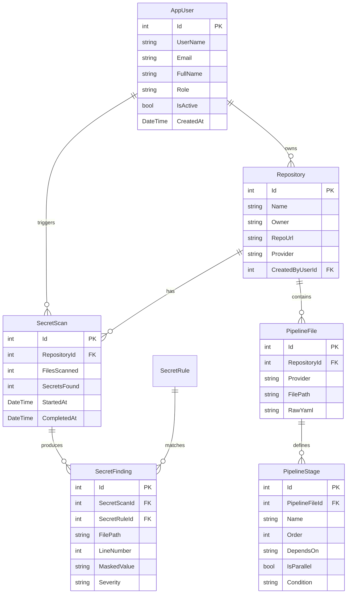

# 🛡️ DeployGuard

> **Continuous CI/CD Security Intelligence, Pattern/Secret Scans & Pipeline Execution Visualizer**

[](https://dotnet.microsoft.com/)
[](https://dotnet.microsoft.com/apps/aspnet/mvc)
[](https://docs.microsoft.com/ef/core/)
[](https://www.questpdf.com/)
[](https://firebase.google.com/)
[](https://getbootstrap.com/)
[](LICENSE)

---

## 📖 Table of Contents
- [Project Overview](#-project-overview)
- [Key Features](#-key-features)
- [System Architecture](#-system-architecture)
- [Technology Stack](#-technology-stack)
- [Directory Structure](#-directory-structure)
- [Getting Started](#-getting-started)
- [How It Works Under the Hood](#-how-it-works-under-the-hood)
  - [1. Shallow Git Ingestion](#1-shallow-git-ingestion)
  - [2. Secret Scanner & Regex Heuristics](#2-secret-scanner--regex-heuristics)
  - [3. CI/CD AST Parser & Visualizer](#3-cicd-ast-parser--visualizer)
  - [4. Vector PDF Audit Reports](#4-vector-pdf-audit-reports)
  - [5. Hybrid Authentication](#5-hybrid-authentication)
- [Database Schema](#-database-schema)
- [Viva & Technical Defense Documentation](#-viva--technical-defense-documentation)
- [Contributing & License](#-contributing--license)

---

## 🌟 Project Overview

**DeployGuard** is an automated DevSecOps platform built with **ASP.NET Core (C# .NET 10)**. It safeguards repositories by proactively detecting hardcoded secrets and credentials in source code and parsing complex CI/CD pipeline workflows into clear, interactive visual Directed Acyclic Graphs (DAGs).

### 🎯 Problems Solved:
1. **Accidental Credential Exposure**: Detects API keys, database passwords, and cryptographic private keys before code reaches production.
2. **CI/CD Visibility & Bottlenecks**: Parses `.github/workflows/*.yml` and `Jenkinsfile` into chronological execution stages.
3. **Audit Compliance**: Produces instant, professional vector PDF audit reports for security teams and administrators.

---

## ✨ Key Features

- 🔍 **High-Speed Static Secret Scanner**: Shallow-clones repositories (`--depth 1`) and inspects files line-by-line in sub-seconds.
- 🔒 **Defense-in-Depth Secret Masking**: Raw tokens are automatically masked (e.g. `AKIA****************1234`) to prevent secondary exposure.
- 🌳 **CI/CD Workflow Visualizer**: Interactive stage graphs displaying sequential order, parallel executions, and prerequisite dependencies (`needs`/`if`).
- 📄 **Instant PDF Export**: Vector-based PDF generation powered by **QuestPDF** with risk radars, severity tables, and remediation guides.
- 🔑 **Hybrid Authentication**: ASP.NET Core Cookie Authentication paired with **Firebase Google Sign-In (OAuth 2.0)**.
- 👑 **Admin Portal & Analytics**: Real-time platform scan metrics, average scan duration, risky repository ranking, and user management.
- 🎨 **Responsive UI/UX**: Compact, zero-scroll authentication screens, sticky top navigation, and modal backdrop isolation.

---

## 🏗️ System Architecture

```
   +-------------------------------------------------------------------------+
   |                            USER INTERFACE                               |
   |   (Login / Google SSO -> Dashboard -> Add Repository -> Details Page)   |
   +-------------------------------------------------------------------------+
                                        │
                                        ▼
   +-------------------------------------------------------------------------+
   |                       REPOSITORY INGESTION LAYER                        |
   |  • RepositoryUrlParser (Extracts Owner, RepoName, Provider)             |
   |  • RepositoryCloneService (git clone --depth 1 <url> to Temp Sandbox)   |
   +-------------------------------------------------------------------------+
                                        │
                    ┌───────────────────┴───────────────────┐
                    ▼                                       ▼
   +---------------------------------+   +---------------------------------+
   |      SECRET SCANNING ENGINE     |   |     CI/CD PIPELINE ENGINE       |
   | • File Traversal & Binary Filter|   | • PipelineDetectionService      |
   | • Regex Pattern Evaluation      |   | • PipelineParserService (YAML)  |
   | • Line, Severity & Masking      |   | • Stage & Dependency Graph      |
   +---------------------------------+   +---------------------------------+
                    │                                       │
                    └───────────────────┬───────────────────┘
                                        ▼
   +-------------------------------------------------------------------------+
   |                       PERSISTENCE & AUDIT LAYER                         |
   |  • Relational Storage (PostgreSQL / SQLite via EF Core)                 |
   |  • QuestPDF Vector Document Generation Engine                           |
   |  • Admin Platform Analytics & User Management                           |
   +-------------------------------------------------------------------------+
```

---

## 💻 Technology Stack

| Layer | Technology | Purpose |
|---|---|---|
| **Framework** | **ASP.NET Core 10 MVC** | High-performance asynchronous backend and routing |
| **Language** | **C# 13 / .NET 10** | Modern type-safe object-oriented codebase |
| **ORM** | **Entity Framework Core 10** | Code-first schema, relational mapping, and migrations |
| **Database** | **PostgreSQL / SQLite** | Persistent relational storage for users, repos, scans |
| **Authentication** | **Cookie Auth + Firebase SDK** | Hybrid authentication with Google OAuth 2.0 Single Sign-On |
| **Git Ingestion** | **Git CLI (`git clone --depth 1`)** | Sub-second shallow repository cloning to sandboxed storage |
| **AST / Parsing** | **YamlDotNet & Custom Lexer** | Parses GitHub Actions YAML and declarative Jenkinsfiles |
| **PDF Generation** | **QuestPDF** | In-memory vector PDF document generation |
| **Frontend** | **Bootstrap 5 & Vanilla JS** | Modern, responsive interface with custom scroll viewports |

---

## 📁 Directory Structure

```
Deployguard/
├── Controllers/
│   ├── AccountController.cs       # Authentication, Login, Register, Google SSO, Logout
│   ├── AdminController.cs         # Admin Dashboard, User Management, Scan Usage Reports
│   ├── HomeController.cs          # Dashboard metrics and overview
│   ├── PipelineController.cs      # CI/CD pipeline stage visualization
│   ├── ReportController.cs        # User PDF audit report generation
│   ├── RepositoryController.cs    # Repository registration, details, scan triggers
│   └── ScanController.cs          # Scan history and finding details
├── Data/
│   └── ApplicationDbContext.cs    # EF Core database context & model relations
├── Models/                        # Domain entities and ViewModels
│   ├── AdminReportViewModel.cs
│   ├── AdminUsersViewModel.cs
│   ├── AppUser.cs
│   ├── PipelineFile.cs
│   ├── PipelineStage.cs
│   ├── Repository.cs
│   ├── SecretFinding.cs
│   ├── SecretRule.cs
│   └── SecretScan.cs
├── Services/
│   ├── Pipeline/                  # CI/CD discovery & AST parsing (YamlDotNet)
│   ├── Providers/                 # Git hosting provider detection
│   ├── Reports/                   # QuestPDF document builders (User & Admin reports)
│   ├── Security/                  # Secret regex rules, clone service, scanner
│   ├── RepositoryService.cs
│   └── RepositoryUrlParser.cs
├── Views/                         # Razor Views & Layouts
│   ├── Account/ (Login, Register)
│   ├── Admin/ (Dashboard, Users, Report, Login)
│   ├── Pipeline/ (Details graph)
│   ├── Repository/ (Index, Details, Create)
│   └── Shared/ (_Layout, _AdminNavbar, _UserNavbar, _GuestNavbar)
├── wwwroot/                       # Static CSS, JavaScript, and Bootstrap assets
├── DEPLOYGUARD_VIVA_GUIDE.txt     # Complete Viva preparation text guide
├── DEPLOYGUARD_VIVA_GUIDE.pdf     # Formatted technical reference PDF
├── appsettings.json               # Database connections and app settings
├── Dockerfile                     # Container deployment definition
└── Program.cs                     # DI service registration and middleware pipeline
```

---

## 🚀 Getting Started

### Prerequisites
- [.NET 10 SDK](https://dotnet.microsoft.com/download)
- [Git CLI](https://git-scm.com/) installed and available on system `PATH`
- [PostgreSQL](https://www.postgresql.org/) (or SQLite)

### 1. Clone the Repository
```bash
git clone https://github.com/jay240322/Deploy-Guard.git
cd Deployguard
```

### 2. Configure Database Connection
Update `appsettings.json` with your connection string:
```json
{
  "ConnectionStrings": {
    "DefaultConnection": "Host=localhost;Database=deployguard;Username=postgres;Password=your_password"
  }
}
```

### 3. Apply Migrations & Build
```bash
dotnet restore
dotnet ef database update
dotnet build
```

### 4. Run the Application
```bash
dotnet run --launch-profile https
```
The application will start on `https://localhost:7270` or `http://localhost:5044`.

---

## ⚙️ How It Works Under the Hood

### 1. Shallow Git Ingestion
When a user registers and triggers a scan for a repository:
```csharp
// RepositoryCloneService.cs executes shallow clone
var arguments = $"clone --depth 1 \"{repositoryUrl}\" \"{targetDirectory}\"";
```
This downloads only the tip commit snapshot without past commit histories, completing ingestion in **under 1 second**.

### 2. Secret Scanner & Regex Heuristics
The engine reads text files line-by-line, excluding `.git` internal objects and binary files (`.png`, `.exe`, `.zip`, `.pdf`, `.dll`), evaluating matches against 16+ predefined security patterns:
- **AWS Keys**: `\bAKIA[0-9A-Z]{16}\b`
- **GitHub PATs**: `\bgh[pousr]_[A-Za-z0-9_]{36,}\b`
- **Stripe Keys**: `\bsk_live_[A-Za-z0-9]{20,}\b`
- **Database Passwords**: `(?i)(db|mysql|postgres)[_-]?(password|pwd)[\s:=]+['"][^'"]{6,}['"]`
- **Private RSA Keys**: `-----BEGIN (RSA|EC|DSA|OPENSSH)? PRIVATE KEY-----`

### 3. CI/CD AST Parser & Visualizer
1. `PipelineDetectionService` discovers workflow files (`.github/workflows/*.yml`, `Jenkinsfile`).
2. `PipelineParserService` uses **YamlDotNet** to construct an AST, extracting jobs, dependencies (`needs`), parallel flags, and conditional clauses (`if`).
3. The UI renders an interactive Directed Acyclic Graph (DAG) with status badges and dependency arrows inside a custom scroll viewport.

### 4. Vector PDF Audit Reports
Using **QuestPDF**, vector-based PDF audit reports are compiled in memory without headless browsers:
- Executive Summary & Risk Radar (Critical, High, Medium, Low)
- Comprehensive Findings Table with File Paths & Line Numbers
- Developer Remediation Guidance

### 5. Hybrid Authentication
- **Local Credentials**: Hashed with `PasswordHasher<AppUser>` (PBKDF2) and validated via ASP.NET Core Cookie Authentication.
- **Google SSO**: Integrated with Firebase Client SDK popup OAuth 2.0, communicating with `/Account/GoogleLogin` for automatic account provisioning.

---

## 📊 Database Schema



---

## 🎓 Viva & Technical Defense Documentation

For academic defense, project presentations, and oral examinations, comprehensive reference documentation is included in the root directory:

- 📄 **[DEPLOYGUARD_VIVA_GUIDE.txt](DEPLOYGUARD_VIVA_GUIDE.txt)**: Plain text guide with architecture details, module mechanics, and top examiner Q&As.
- 📑 **[DEPLOYGUARD_VIVA_GUIDE.pdf](DEPLOYGUARD_VIVA_GUIDE.pdf)**: Formatted, printable vector PDF reference guide.

---

## 📄 License & Author

- **Author**: Jay ([@jay240322](https://github.com/jay240322))
- **Project**: DeployGuard Security Platform
- **License**: MIT License
