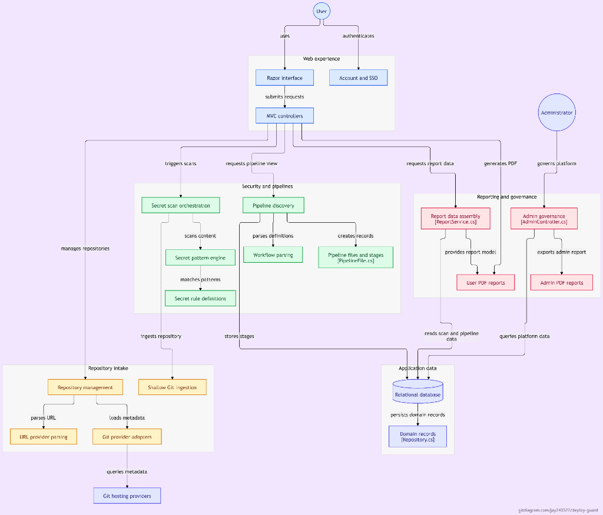
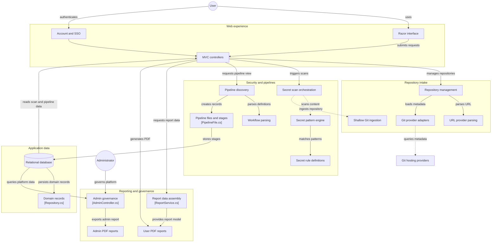
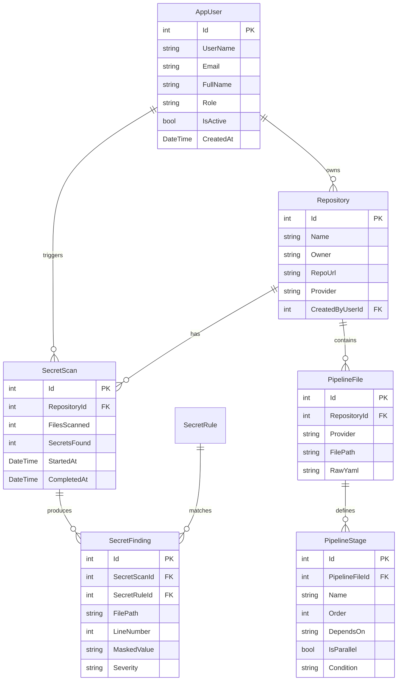

<div align="center">

  

  # DeployGuard
  ### Enterprise DevSecOps Intelligence, Static Secret Detection & CI/CD Pipeline Visualizer

  [](https://dotnet.microsoft.com/)
  [](https://dotnet.microsoft.com/apps/aspnet/mvc)
  [](https://www.postgresql.org/)
  [](https://www.questpdf.com/)
  [](https://firebase.google.com/)
  [](https://getbootstrap.com/)
  [](LICENSE)

  <p align="center">
    <strong>DeployGuard</strong> continuously inspects Git repositories for exposed API credentials, database keys, and CI/CD pipeline vulnerabilities in seconds before deployment.
  </p>

  <p align="center">
    <a href="#-key-features">Key Features</a> •
    <a href="#-system-architecture">Architecture</a> •
    <a href="#-technology-stack">Tech Stack</a> •
    <a href="#-quick-start">Quick Start</a> •
    <a href="#-how-it-works">How It Works</a> •
    <a href="#-database-schema">Database Schema</a>
  </p>

</div>

---

## 🌟 Overview

**DeployGuard** is an automated DevSecOps platform built with **ASP.NET Core (.NET 10)**. It safeguards software organizations by proactively detecting hardcoded secrets, leaked tokens, and cloud credentials in source repositories while parsing complex CI/CD pipeline workflows into interactive, visual Directed Acyclic Graphs (DAGs).

### 🎯 Problems Solved:
1. **Accidental Credential Leaks**: Detects API keys, database connection strings, and cryptographic private keys before code reaches production.
2. **CI/CD Pipeline Observability**: Parses `.github/workflows/*.yml` and `Jenkinsfile` into structured execution stages with dependency trees.
3. **Audit Readiness**: Generates executive vector PDF reports for compliance and security auditing.
4. **Sandboxed Security**: Zero data retention architecture using isolated shallow Git ingestion.

---

## ✨ Key Features

- 🔍 **Sub-Second Secret Detection**: High-speed line-by-line static code analyzer matching against 16+ enterprise pattern definitions (AWS, GitHub, Stripe, RSA, JWT, DB URIs).
- 🛡️ **Defense-in-Depth Token Masking**: Raw secrets are masked at the service boundary (e.g. `AKIA****************1234`) to prevent secondary leakage in logs or reports.
- 🌳 **Interactive CI/CD Graph Visualizer**: AST-based workflow parser mapping jobs, prerequisite dependencies (`needs`), parallel execution flags, and execution conditions (`if`).
- 📊 **Executive Vector PDF Audits**: Powered by **QuestPDF** to generate crisp, high-resolution audit reports with severity risk radars and line-by-line remediation guides.
- 🔐 **Hybrid Security & Single Sign-On**: ASP.NET Core Cookie Authentication paired with **Firebase Google OAuth 2.0 Single Sign-On**.
- 👑 **Admin Governance Portal**: Global platform health dashboard, risky repository ranking, user authorization management, and PDF intelligence export.
- 🎨 **Modern Design Engine**: Responsive dark/light theme switching, sticky blurred header, custom micro-animations, and unified Google Font typography (**Plus Jakarta Sans**).
- ⚡ **Global Loading & Processing Engine**: Smooth debounce-driven loading overlays and button-level spinner indicators on long-running tasks.

---

## 🏗️ System Architecture

<div align="center">
  
</div>

<br/>



---

## 💻 Technology Stack

| Layer | Technology | Description |
|---|---|---|
| **Framework** | **ASP.NET Core 10 (MVC)** | High-throughput asynchronous web application framework |
| **Language** | **C# 13 / .NET 10** | Modern, type-safe backend programming language |
| **ORM & Data** | **Entity Framework Core 10** | Code-First migrations, automated seeding, and relational queries |
| **Database** | **PostgreSQL / SQLite** | High-performance ACID relational storage |
| **PDF Generation** | **QuestPDF** | In-memory fluent vector document layout engine |
| **Workflow Parsing** | **YamlDotNet** | Abstract Syntax Tree (AST) parser for GitHub Actions & Jenkinsfiles |
| **Authentication** | **Cookie Auth + Firebase SDK** | Secure PBKDF2 password hashing & Google OAuth 2.0 Single Sign-On |
| **Styling & UI** | **Bootstrap 5.3 + Vanilla CSS** | Custom design system with dark/light themes and Google Fonts |

---

## 📁 Directory Structure

```
Deployguard/
├── Controllers/
│   ├── AccountController.cs       # Authentication, Login, Register, Google SSO, Logout
│   ├── AdminController.cs         # Admin Dashboard, User Management, Scan Reports
│   ├── HomeController.cs          # Landing page and user overview dashboard
│   ├── PipelineController.cs      # CI/CD pipeline stage visualization
│   ├── ReportController.cs        # User PDF audit report downloads
│   ├── RepositoryController.cs    # Git repository management and scan triggers
│   └── ScanController.cs          # Scan history, detail findings & remediation
├── Data/
│   └── ApplicationDbContext.cs    # EF Core context, entity models & relationships
├── Models/                        # Domain entities and ViewModels
│   ├── AdminReportViewModel.cs
│   ├── AdminUsersViewModel.cs
│   ├── AppUser.cs
│   ├── PipelineFile.cs
│   ├── PipelineStage.cs
│   ├── Repository.cs
│   ├── SecretFinding.cs
│   ├── SecretRule.cs
│   └── SecretScan.cs
├── Services/
│   ├── Pipeline/                  # Workflow discovery & AST YAML parsers
│   ├── Providers/                 # Git provider detection (GitHub, GitLab, Bitbucket, Azure DevOps)
│   ├── Reports/                   # QuestPDF builders for User and Admin PDF reports
│   ├── Security/                  # Sandbox shallow clone and static regex pattern scanner
│   ├── RepositoryService.cs
│   └── RepositoryUrlParser.cs
├── Views/                         # Razor Views & Layouts
│   ├── Account/ (Login, Register)
│   ├── Admin/ (Dashboard, Users, Report, Login)
│   ├── Home/ (Landing, Dashboard, Privacy)
│   ├── Pipeline/ (Details graph)
│   ├── Repository/ (Index, Details, Create, Edit)
│   ├── Scan/ (History, Details)
│   └── Shared/ (_Layout, _GuestNavbar, _UserNavbar, _AdminNavbar)
├── wwwroot/                       # Static assets (CSS, JS, Logo images, Bootstrap)
│   ├── images/
│   │   ├── logo.png               # Official DeployGuard Logo
│   │   └── architecture-diagram.png # System architecture diagram
│   ├── css/site.css               # Global design tokens and theme engine
│   └── js/site.js                 # Theme switcher, UTC time formatters, global loader
├── appsettings.json               # App configuration & connection strings
├── Program.cs                     # DI service registrations, EF migrations & middleware
└── Dockerfile                     # Production container deployment definition
```

---

## 🚀 Quick Start

### Prerequisites
- [.NET 10 SDK](https://dotnet.microsoft.com/download)
- [Git CLI](https://git-scm.com/) installed and on system `PATH`
- [PostgreSQL](https://www.postgresql.org/) (or SQLite)

### 1. Clone the Repository
```bash
git clone https://github.com/jay240322/Deploy-Guard.git
cd Deployguard
```

### 2. Configure Connection String
Update `appsettings.json` with your database credentials:
```json
{
  "ConnectionStrings": {
    "DefaultConnection": "Host=localhost;Database=deployguard;Username=postgres;Password=your_password"
  }
}
```

### 3. Build & Run
```powershell
# Restore dependencies and build
dotnet build

# Launch application on HTTPS
dotnet run --launch-profile "https"
```

Access the application in your browser:
- **HTTPS**: `https://localhost:7270`
- **HTTP**: `http://localhost:5044`

---

## ⚙️ How It Works

### 1. Sandboxed Shallow Ingestion
When a scan is triggered, DeployGuard clones only the tip commit snapshot without past commit histories:
```bash
git clone --depth 1 "<repository-url>" "<sandbox-temp-directory>"
```
This enables repository ingestion in **under 1 second** while keeping server memory footprints minimal.

### 2. Static Secret Scanning Engine
The scanner traverses text files while ignoring binary formats (`.png`, `.exe`, `.zip`, `.pdf`, `.dll`) and internal `.git` directories, checking against regex definitions:
- **AWS Access Keys**: `\bAKIA[0-9A-Z]{16}\b`
- **GitHub Personal Access Tokens**: `\bgh[pousr]_[A-Za-z0-9_]{36,}\b`
- **Stripe Secret Keys**: `\bsk_live_[A-Za-z0-9]{20,}\b`
- **Database Connection URIs**: `(?i)(db|mysql|postgres)[_-]?(password|pwd)[\s:=]+['"][^'"]{6,}['"]`
- **Private Cryptographic Keys**: `-----BEGIN (RSA|EC|DSA|OPENSSH)? PRIVATE KEY-----`

### 3. CI/CD AST Parsing & Dependency Mapping
1. `PipelineDetectionService` discovers workflow files (`.github/workflows/*.yml`, `Jenkinsfile`).
2. `PipelineParserService` utilizes **YamlDotNet** to construct an AST, extracting jobs, dependencies (`needs`), parallel flags, and conditional clauses (`if`).
3. The UI renders an interactive Directed Acyclic Graph (DAG) with visual status indicators.

---

## 📊 Database Schema


